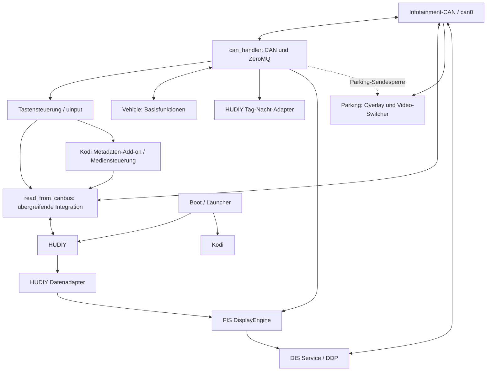

# Architektur und Begriffe

[Startseite](../README.md) · [Dateizuordnung](PFADZUORDNUNG.md) · [Startwege](STARTWEGE.md)

**Belegt** bedeutet: im geprüften Quellstand vorhanden. **Offen** bedeutet: ohne laufenden Pi, fehlende Datei oder Hardwarebeleg nicht bestätigt. Die fachliche Ordnerstruktur ist umgesetzt; das macht aus dem vorhandenen Integrationsmonolithen noch kein getrenntes Modulsystem. Die Pfade im historischen Quellbefund bezeichnen teilweise die ursprüngliche Ablage; aktuelle Ziele sind verlinkt und im [Pfadinventar](path-migration.json) vollständig zugeordnet.

Ein Dienst ist ein dauerhaft laufendes Programm. systemd startet und überwacht Dienste; Cron kann ebenfalls Programme beim Boot starten. Eine Oberfläche zeigt Inhalte an. Ein Adapter übersetzt zwischen Schnittstellen. ZeroMQ ist hier ein lokaler Nachrichtenverteiler; SocketCAN die Linux-Schnittstelle zum Fahrzeugbus. FIS/DIS bezeichnet das Display im Kombiinstrument, OPS die optische Parkanzeige und PDC die Abstandserfassung.

Die gestrichelte Verbindung ist eine gemeinsame Wirkung, kein direkter Aufruf. Der CAN-Handler ist **nicht der einzige CAN-Zugriff**: DDP, Parking und read_from_canbus öffnen eigene Busverbindungen. Seine Sendesperre greift nicht automatisch für andere Programme.

## Kodi

[kodi/](../apps/kodi) enthält parallele Ablagen: einzelne Konfigurationen und Skin-Dateien sowie userdata/ und addons/. Skin-Bestände liegen unter addons/skin.estuary.custom/, skin.estuary.custom/ und skin/; zusätzlich ist etwa addons/skin.apptv/ vorhanden. Daraus lässt sich weder der aktive Skin noch eine allgemeine Kopierreihenfolge ableiten.

Die Medienkette ist nachvollziehbar: [can_keyboard_control.py](../mira-core/input/can_keyboard_control.py), Funktion send_rnse_media_command, sendet next/previous per UDP an 127.0.0.1:23457. [service.rnse.metadata/service.py](../apps/kodi/addons/service.rnse.metadata/service.py) empfängt und verteilt Befehle unter anderem an [rnse_media_router.py](../apps/kodi/userdata/rnse_media_router.py) und [music_status.py](../apps/kodi/scripts/music_status.py). Die Kodi-Tastenbelegung kann den Router auch direkt starten. music_status benötigt Kodis Python-Module; trotz übergreifender Medienaufgabe ist es derzeit kein eigenständiger globaler Dienst.

Das Metadaten-Add-on schreibt /run/user/1000/rnse_kodi_radio_metadata.json. Die übergreifende Integrationslogik kann Kodi-Metadaten für das FIS verwenden. Wetter läuft unter anderem über live_sync_worker.py; Waipu hat einen eigenen Proxy-Dienst. Siehe [Startwege](STARTWEGE.md).

## HUDIY

[dark_mode_api.py](../apps/hudiy/integration/dark_mode_api.py) empfängt Lichtdaten vom CAN-Handler über ZeroMQ und sendet an HUDIY auf Port 44405. [hudiy_data.py](../apps/hudiy/integration/hudiy_data.py) arbeitet in der anderen Richtung: Medien-, Navigations- und Telefonereignisse aus HUDIY werden über ZeroMQ und /tmp/now_playing.json, /tmp/current_nav.json und /tmp/current_call.json bereitgestellt. Es ist nicht einfach ein Sender von Fahrzeugdaten an HUDIY, wie die frühere README nahelegte.

Fahrzeugdatenübertragung an HUDIY ist auch in [read_from_canbus.py](../mira-core/integration/read_from_canbus.py) enthalten. [hudiy_startup.sh](../apps/hudiy/integration/hudiy_startup.sh) konfiguriert Audio über pactl und startet die externe Anwendung unter ~/.hudiy/share/. Voraussetzung ist die separat installierte HUDIY-Umgebung. [Herkunft und Grenzen](../recovery/HUDIY_SOURCE.md).

## Globale Mira-Core-Funktionen

**Tasten:** can_keyboard_control übersetzt CAN-Eingaben in Linux-Tasten über uinput, sendet FIS-Kommandos über TCP 23456 und Medienkommandos über UDP 23457. Die Zuordnung ist global, die Reaktion hängt von Oberfläche und Empfänger ab. input_watchdog und can_health_monitor ergänzen Überwachung.

**FIS:** [dis_display.py](../mira-core/fis/dis_display.py) verarbeitet CAN- und HUDIY-Ereignisse, nutzt dis_client/apps/ und schickt Zeichenbefehle an [dis_service.py](../mira-core/fis/dis_service.py). Dieser spricht über [ddp_protocol.py](../mira-core/fis/ddp_protocol.py) mit dem Kombiinstrument. Das umfasst mehr als die oberen zwei Textzeilen. Daneben enthält read_from_canbus eigene FIS-Ausgaben. Welche Variante am Pi zuständig ist, bleibt offen. dis_toplines.service verweist auf eine fehlende Datei, nicht auf diese vorhandenen Programme.

**Medien:** gemeinsame Bedienung und Metadaten über Kodi-, HUDIY- und FIS-Grenzen. USB-Mount und Indexer liegen in scripts/, schreiben aber derzeit in Kodis Benutzerverzeichnis. Bluetooth-/Audio-Skripte und Kodi-Adapter gehören zur Kette; ihre Laufzeitabhängigkeit von Kodi darf bei einer Sortierung nicht verloren gehen.

**Übergreifende Integration:** read_from_canbus bündelt Fahrzeugauswertung, FIS, HUDIY-API, App-Wechsel, Fernsteuerung und eine eigene Kameraimplementierung. Die neben dem Skript geladene [features.conf](../scripts/features.conf) schaltet Funktionen. Im geprüften Stand sind CAN-Senden, Fahrzeug-/Medienausgabe zum FIS, HUDIY-Gauges und Lichtumschaltung an; automatische Kamera und Kamera-Langdruck sind aus. Dies belegt die eingecheckte, nicht die aktive Fahrzeugkonfiguration. Das Skript ist kein reines Diagnosewerkzeug.

## Vehicle

[can_handler.py](../vehicle/can/can_handler.py) verteilt empfangene Frames als Topic CAN_… und JSON an ZeroMQ-Abonnenten. Ein separater Eingang nimmt Sendeaufträge an. Adressen kommen aus /home/pi/config.json, die im Repository fehlt.

[can_base_function.py](../vehicle/power-time/can_base_function.py) kann konfigurationsabhängig TV-Präsenz senden, die Uhr synchronisieren, bei Zündungs-/Schlüsselzuständen oder ausbleibenden Nachrichten herunterfahren und eine CarPiHat-Stromhalteleitung bedienen. Das ist mehr als bloßes Auslesen von Beleuchtung und Geschwindigkeit.

[system/config.txt](../vehicle/platform/config.txt) enthält MCP2515 mit 12-MHz-Oszillator, SPI, KMS und DAC-Konfiguration. [80-can.network](../vehicle/can/network/80-can.network) und can0-setup.service konfigurieren beide 100 kbit/s auf unterschiedlichen Startwegen. Ihr Einsatz muss vor Änderungen geprüft werden.

## Parking

Kamera, Videoquellenumschaltung und OPS/PDC bilden eine gemeinsame Kette mit Überschneidungen zu Vehicle und Core sowie externer Hardware. [Parking](PARKING.md) trennt belegte Softwarewirkung von offenen Hardwareannahmen.

## Boot und Launcher

[boot_launcher.py](../platform/launcher/boot_launcher.py) ist eine PyQt5-Auswahloberfläche. launch_kodi.sh beendet HUDIY und startet Kodi; launch_hudiy.sh beendet Kodi und startet HUDIY. Beide schreiben /run/user/1000/rnse_active_app. Animation: boot/mira-animation/; weitere Boot-Ordner enthalten Übergangs- und Diagnosevarianten.

Systemd-Launcher und labwc-Autostarts sind alternative bzw. potenziell konkurrierende Startwege. config/labwc/autostart startet HUDIY direkt, die Recovery-Sicherung des systemweiten Autostarts startet den Launcher. Nicht pauschal alle Varianten aktivieren.

## Recovery und Abhängigkeiten

Zusätzlich zu Git werden installierte Pfade, aktive Units, lokale Konfiguration, Python-Umgebungen, HUDIY, Betriebssystem und Hardwarekonfiguration benötigt. Bibliotheken im Code sind unter anderem python-can, pyzmq, uinput, PyQt5, GStreamer/GI/Cairo und RPi.GPIO; Kodi-Skripte benötigen Kodi. Ein gemeinsames vollständiges, getestetes Installationsmanifest ist nicht belegt. [Recovery](../recovery/README.md) beginnt mit Bestandsaufnahme und Sicherung.
