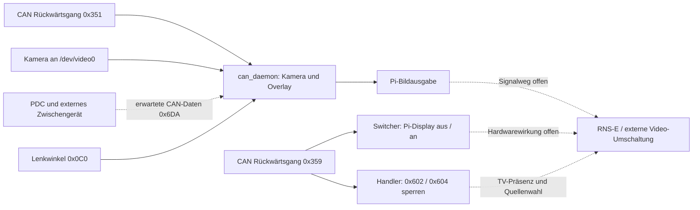

# Parking: Rückfahrkamera, Videoquellenumschaltung und OPS/PDC

[Startseite](../README.md) · [Prüfbefunde](PRUEFBEFUNDE.md)

Das ist **ein zusammenhängendes System**: Rückwärtsgang erkennen, die passende Bildquelle sichtbar machen, Kamera und Abstandsinformation darstellen und zur normalen Oberfläche zurückkehren. Vorhandene Programme erfüllen Teilaufgaben. Ihre gemeinsame Aktivierung ist nicht als funktionierende Gesamtkette nachgewiesen.

## Belegte Zuständigkeiten

| Teil | Eingang | Tatsächliche Wirkung | Quellbeleg |
|---|---|---|---|
| CAN-Handler | 0x359, Byte 0, Maske 0x02 | Sperrt aus ZeroMQ kommende Sendeaufträge für **0x602 und 0x604** während Rückwärtsfahrt und Nachlauf | [can_handler.py, main](../can/rns-e_can/can_handler.py) |
| Video-Switcher | ebenfalls 0x359 / Byte 0 / 0x02 | vcgencmd display_power 0; nach Rückwärtsgang-Ende und 2 s display_power 1 | [rnse_ops_switcher.py](../scripts/rnse_ops_switcher.py) |
| CanDaemon / Kamera-Overlay | 0x351, Byte 0 = 0x52 oder 0x02 | Startet Kamera-Pipeline; anderer Bytewert beendet sie | [can_daemon.py, can_listener](../can/audi-rns-overlay/can_daemon.py) |
| Dynamische Führungslinien | 0x0C0, Bytes 1/2, vorzeichenbehaftet, Faktor 0,04375 | Aktualisiert Lenkwinkel für gezeichnete Linien | dieselbe Datei |
| OPS/PDC | 0x6DA, Byte 1 = 0x92 vorn / 0x93 hinten, Bytes 2–5 | Aktualisiert je vier Sensorbereiche | dieselbe Datei |
| Zweiter Kamerapfad | 0x351, Anfang 02 / 00, sofern Feature aktiv | Eigene lokale GStreamer-Kamera mit Nachlauf-/Geschwindigkeitslogik | [read_from_canbus.py, process_canid_351 / local_camera_action](../scripts/read_from_canbus.py) |
| Manueller Befehl | HTTP /revcam_toggle | Sendet toggle_revcam_no_lines an TCP 23456; im vorhandenen Empfänger fehlt die Behandlung | [pi_control.py](../scripts/pi_control.py), read_from_canbus / handle_client |

Der Handler prüft seinen 2-s-Nachlauf nur innerhalb der Verarbeitung empfangener Nachrichten. Beim Switcher läuft die Zeitprüfung auch nach einem Empfangs-Timeout. Es gibt keinen gemeinsamen Zustandsautomaten.

## Bild- und Datenweg

can_daemon enthält konkret AudiMmiOverlay: /dev/video0 → GStreamer mit Deinterlacing, Beschnitt und Skalierung auf 800×480 → Cairo-Overlay → Wayland-Ausgabe. Keine im Browser gezeichnete OPS-Oberfläche. car_top.png und optional camera_bg.jpg werden unter /home/pi/audi-rns-overlay/ erwartet; sie fehlen in diesem Repository-Ordner.

PDC-Daten bezeichnet der Kommentar als Arduino-/K-Line-Daten eines 8E0-919-283. Der Code setzt Zentimeterwerte in Anzeigestufen um; 00, FE und FF ergeben keine Hindernisanzeige. **Das ist eine Softwareannahme, kein Nachweis für das verbaute Zwischengerät, dessen Firmware, Verkabelung oder Messwertkodierung.** Entsprechende Firmware ist im geprüften Bestand nicht enthalten. Der VGA-Sync-Combiner beschreibt RGBHV→RGBS; daraus folgt nicht, dass er dieses Parking-Zwischengerät ist.

## Offene Verknüpfungen und Konflikte

1. **Unterschiedliche Trigger:** 0x359 und 0x351 werden nicht miteinander übersetzt. Welche Frames auf dem angeschlossenen Infotainment-CAN vorliegen, muss ein passiver Mitschnitt bestätigen. Der Lenkwinkel ist im Code als Antriebs-CAN bezeichnet; seine Verfügbarkeit bleibt offen.
2. **Möglicher Zielkonflikt:** Der Switcher schaltet die Pi-Bildausgabe ab, während das Overlay ein Pi-Bild erzeugt. Ob das RNS-E dann auf eine externe Quelle schaltet, welche Hardware dies veranlasst und wann das Pi-Overlay sichtbar sein soll, ist nicht belegt. Der vcgencmd-Erfolg wird nicht ausgewertet; die Wirkung unter KMS ist unbestätigt.
3. **Keine direkte Kopplung:** Switcher und Overlay lesen selbst CAN. Zwischen ihnen gibt es weder API-Aufruf noch systemd-Abhängigkeit. Die Handler-Sperre gilt nur für seinen Sendeweg. read_from_canbus enthält eigenes direktes TV-Präsenz-Senden, im eingecheckten Feature-Stand deaktiviert.
4. **Doppelte Overlay-Units:** audi-camera-overlay.service und rns-overlay.service starten denselben can_daemon und HTTP-Port 44408. Diesen Port nutzt auch pi_control. Gleichzeitiger Betrieb kann Port- und Kamera-Konflikte verursachen; das erwartete Overlay-Verzeichnis html fehlt.
5. **Weiterer Kamerabesitzer:** read_from_canbus kann ebenfalls /dev/video0 nutzen. Seine beiden automatischen Kamera-Features stehen in scripts/features.conf auf False; lokal installierte Varianten sind nicht geprüft.
6. **Unvollständiger manueller Weg:** Der HTTP-Endpunkt kann erfolgreiches Senden melden, obwohl handle_client den Befehl als unbekannt behandelt. Keine Funktionsgarantie für diesen Knopf.

## Noch am Fahrzeug erheben

- Hersteller, Modell, Firmware und Anschlüsse des Zwischengeräts; Kameraeingang und tatsächlicher Videoausgang zum RNS-E.
- Welche Parking-Units und Cron-Prozesse laufen?
- Passive Aufzeichnung von 0x359, 0x351, 0x0C0 und 0x6DA bei bekannten Zuständen; keine unbekannten Testframes einspeisen.
- Bildfolge bei Rückwärtsgang ein/aus, PDC ohne Rückwärtsgang und Kameraausfall; welcher Teil zeichnet OPS, welcher schaltet die Quelle?

Erst danach lässt sich ein gemeinsamer Zustandsablauf festlegen. Diese Änderung aktiviert, deaktiviert oder repariert keine Komponenten. Lesende Befehle: [Recovery](../recovery/README.md).
